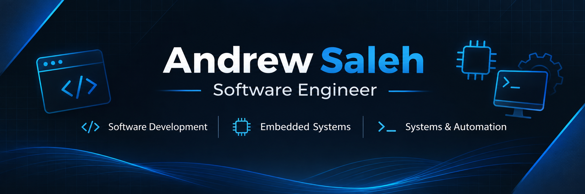

<!-- GitHub Profile Banner -->

  

<h1 align="center">Hi, I'm Andrew 👋</h1>

<h3 align="center">Software Engineer</h3>

  I enjoy building reliable software, solving challenging problems,
  and exploring new technologies.

  
  
  
  

  
  

---

## 👨‍💻 About Me

I'm a software engineer with experience in **C/C++, Python, Linux, and embedded systems**.

I enjoy working across different areas of software development, from low-level programming to applications and automation.

I'm always interested in learning, collaborating, and finding thoughtful ways to solve technical problems.

## ⚡ Areas of Interest

- 💻 Software engineering and system design
- 🔧 Embedded systems and connected technologies
- ⚙️ Developer tools, automation, and CI/CD
- 🚀 Building practical applications and exploring new technologies

---

  <i>Always learning. Always building.</i>

